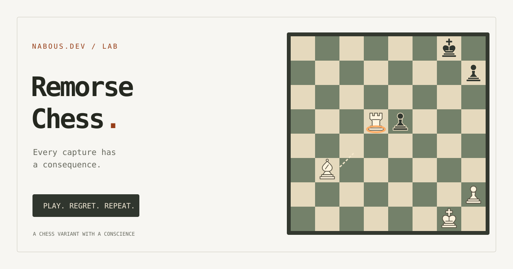

# Remorse Chess

**Every capture has a consequence.**

A small, dependency-free browser implementation of the Remorse Chess variant popularized by [Bardelo Bardalini](https://www.youtube.com/shorts/H-JyKN_1jM4). Built by [Mohamed Nabous](https://nabous.dev/).

**[Play on nabous.dev →](https://nabous.dev/lab/remorse-chess/)**



## Play

Select a piece, then a highlighted destination. On a keyboard, use the arrow keys to navigate the board and Enter or Space to select. Escape clears the selection.

- Play against the computer at three search levels, as either colour.
- Play a friend locally on the same device.
- Capturing pieces receive a visible orange remorse ring.
- Moving a bishop next to guilty allies grants absolution, shown in green.
- The guided example demonstrates the mechanic without losing your current game.
- Progress saves automatically in the current browser. Undo restores both the position and remorse state.
- Flip the board, choose a promotion, and optionally enable synthesized sound.
- The board supports touch, keyboard navigation, reduced motion and the host site's light/dark theme.

## Rules

The starting point is normal chess. A capture makes its piece remorseful: it can move to empty squares and block, but cannot capture or give check. A friendly bishop that **moves** to an adjoining square absolves it.

The brief public description leaves several details open. This implementation makes the following choices explicit in the game:

1. All eight surrounding squares count as adjoining. A bishop move absolves **all** remorseful allies in those squares.
2. The bishop must move. Moving a guilty piece beside a stationary bishop, or capturing next to one, does not trigger absolution.
3. Bishops also acquire remorse. They can still absolve others while remorseful, but cannot absolve themselves.
4. Remorse persists through promotion. Promoting into a bishop does not trigger absolution on that move.
5. Kings cannot be captured and must stay on non-adjacent squares, including when remorseful.
6. Check, checkmate, castling and en passant account for the changed attack map. A bishop move may restore an ally's attack and deliver check.
7. Stalemate, threefold repetition, fifty moves without a pawn move or capture, and bare kings automatically end the game in a draw. Repetition includes the remorse state of every piece. Other orthodox material-draw shortcuts are not assumed.

These are documented implementation rulings, not a claim that the original short video specifies every edge case.

## Run locally

Requires Node.js 20 or later. No dependency installation or build step is needed.

```sh
cd experiments/remorse-chess
npm start
```

Open `http://localhost:4173`. To change the port, run `PORT=8080 npm start`.

```sh
npm test
```

The automated suite covers remorse, absolution, checks, king safety, castling, en passant, promotion, repetition, draws, immutable snapshots and computer move legality. The site CI also runs these tests.

## Structure

| File | Purpose |
| --- | --- |
| `public/lab/engine.js` | Pure, immutable rules engine and small alpha-beta computer opponent |
| `public/lab/app.js` | Board, dialogs, keyboard controls, saved games, tutorial and undo |
| `public/lab/worker.js` | Computer search off the main UI thread |
| `public/lab/pieces.js` | Original SVG chess pieces |
| `public/lab/style.css` | Responsive board and scoped styles |
| `public/blog.md` | Article and lab-card metadata |
| `tests/engine.test.js` | Rule and computer regression tests |

The game can be served by any static HTTP server. JavaScript modules require HTTP; opening `index.html` directly from the filesystem is not supported. The computer is a small variant-aware search engine, not Stockfish, and has no Elo rating. There is no online multiplayer, account system or game-data backend. Saved games remain in this browser's local storage.

## Hosting in the lab

`config/projects.json` in the parent site registers this directory as a public project source. The lab serves `public/lab/` at `/lab/remorse-chess/`, injects the site's navigation and theme, and links back to this source directory. Relative asset URLs allow the same game to run on its own.

## Credits

- Variant inspiration: [Bardelo Bardalini — Remorse Chess](https://www.youtube.com/shorts/H-JyKN_1jM4).
- Public rules description: [Neatorama, 16 November 2026](https://www.neatorama.com/2026/11/16/Remorse-Chess-When-Your-Pieces-Feel-Guilty/).
- Browser implementation, original vector pieces and visual design: Mohamed Nabous.
